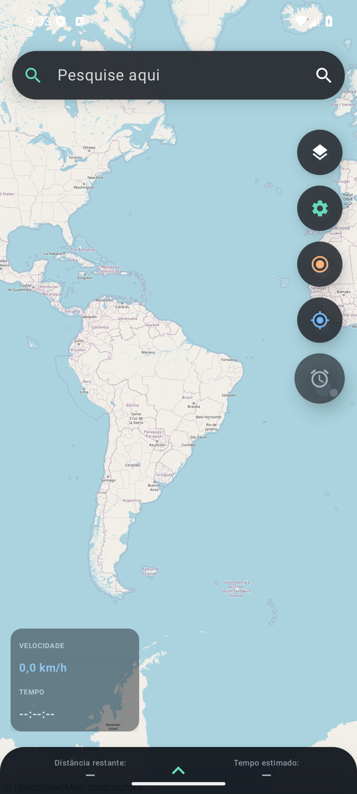
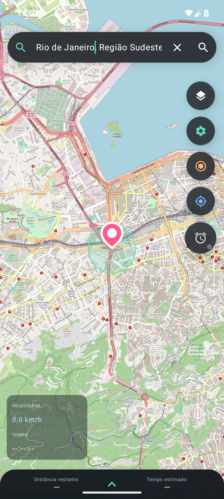
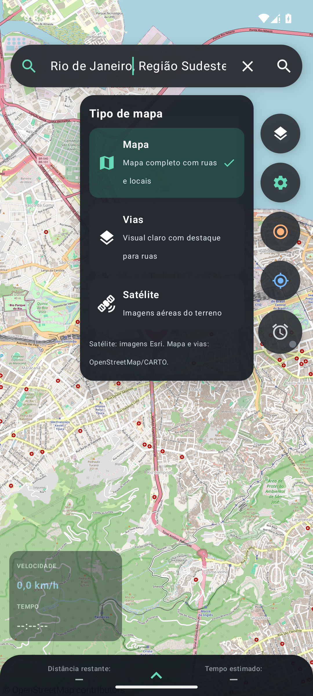
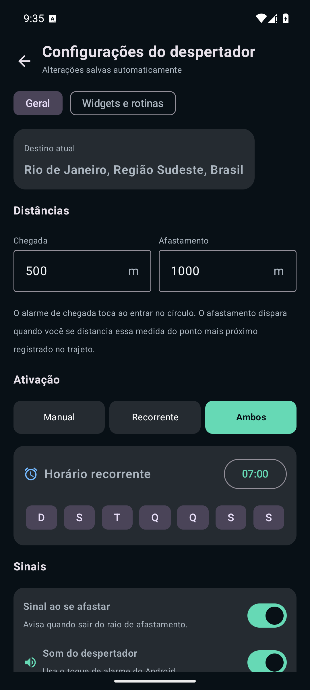
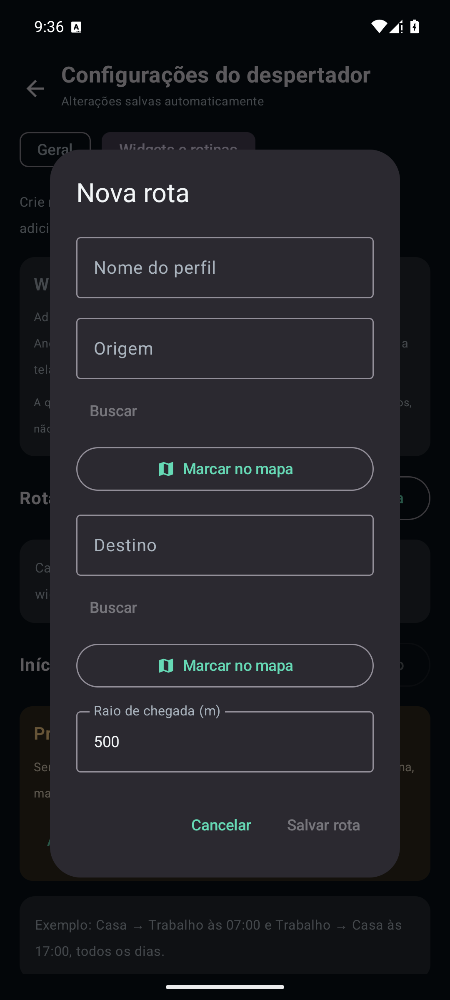

# Desperta no Ponto

Aplicativo Android que acompanha um trajeto por GPS e avisa quando o aparelho chega ao raio definido para o destino. O projeto também registra viagens concluídas e permite iniciar rotas salvas por widget ou em horários recorrentes.

> O app é um alerta de chegada; não oferece navegação curva a curva nem substitui um aplicativo de mapas.

## Recursos

- Escolha o destino pesquisando um endereço ou marcando um ponto no mapa.
- Configure o raio de chegada em metros, medido do centro do destino até a borda do círculo exibido no mapa.
- Acompanhe posição, velocidade GPS, distância restante, previsão de chegada e cronômetro do trajeto.
- Mantenha o acompanhamento em segundo plano por um serviço de localização em primeiro plano e uma notificação persistente.
- Receba um alarme ao entrar no raio de chegada; configure por quantos segundos ele toca antes de ser encerrado automaticamente. O acompanhamento é encerrado na chegada.
- Configure um alerta separado ao sair de um raio de afastamento, além de som e vibração.
- Consulte o histórico agrupado por origem e destino, com média, menor e maior duração, gráficos e viagens individuais. Os detalhes incluem agrupamentos por dia da semana, mês e ano.
- Cadastre rotas com origem, destino e raio próprios. Adicione um widget para iniciar cada rota salva com um toque.
- Programe inícios recorrentes por horário e dias da semana, com anúncio por voz opcional.
- Reagende rotinas após reinicialização do aparelho ou alterações de data e fuso horário.
- Mantenha o resumo inferior do destino recolhido ao abrir o app; ele pode ser expandido manualmente.

## Capturas de tela

Capturas feitas com o aplicativo em execução em um Pixel 6 virtual (Android 15). O destino exibido é uma busca pública por “Rio de Janeiro”; não foi usada a localização pessoal do usuário. A permissão de localização não foi concedida durante esta demonstração, portanto o GPS real não está representado.

<table>
  <tr>
    <td align="center"><br/>Apresentação</td>
    <td align="center"><br/>Mapa principal</td>
    <td align="center"><br/>Destino e raio</td>
  </tr>
  <tr>
    <td align="center"><br/>Camadas do mapa</td>
    <td align="center"><br/>Configurações gerais</td>
    <td align="center"><br/>Widgets e rotinas</td>
  </tr>
  <tr>
    <td align="center"><br/>Cadastro de rota</td>
  </tr>
</table>

## Requisitos

- Android 8.0 (API 26) ou superior.
- Android Studio com suporte a projetos Gradle Kotlin DSL.
- JDK 17 ou superior (JDK 21 também é compatível).
- Conexão com a internet para carregar mapas e pesquisar endereços. O acompanhamento GPS já iniciado pode continuar sem carregar os mapas.

| Componente | Versão configurada |
| --- | --- |
| Android Gradle Plugin | 8.7.3 |
| Gradle Wrapper | 8.10.2 |
| Kotlin | 2.0.21 |
| `compileSdk` / `targetSdk` | 35 / 35 |
| `minSdk` | 26 |
| Versão do app | 1.1.7 (`versionCode` 18) |

## Compilar

Clone o repositório e abra a pasta no Android Studio, ou use o terminal na raiz do projeto.

No Windows PowerShell:

```powershell
.\gradlew.bat assembleDebug
```

No macOS ou Linux:

```bash
./gradlew assembleDebug
```

O APK de depuração será criado em:

```text
app/build/outputs/apk/debug/app-debug.apk
```

Para executar as verificações disponíveis:

```powershell
.\gradlew.bat testDebugUnitTest lintDebug
```

O projeto atualmente não contém testes unitários automatizados; `testDebugUnitTest` pode terminar como `NO-SOURCE`. O lint e a compilação continuam sendo verificações úteis, mas não substituem testes de GPS e alarmes em um aparelho real.

Para instalar em um aparelho conectado por ADB:

```powershell
adb install -r app\build\outputs\apk\debug\app-debug.apk
```

O Android Studio gera o arquivo `local.properties` da máquina. Ele não deve ser versionado. A distribuição de produção requer uma chave de assinatura própria; não inclua keystores ou senhas no repositório.

## Primeiros passos no aparelho

1. Instale e abra o app.
2. Conceda acesso à localização enquanto usa o app. Conceda também localização em segundo plano se for usar horários automáticos.
3. Pesquise um destino ou marque um ponto no mapa e confirme o raio de chegada nas configurações.
4. Inicie o acompanhamento pela tela principal, por um widget configurado ou por uma rotina recorrente.
5. Para rotas automáticas, abra **Configurações → Widgets e rotinas**, cadastre origem e destino e depois configure o widget ou o horário.
6. Se o Android solicitar, autorize notificações e alarmes/lembretes. Sem autorização para alarmes exatos, o sistema ainda pode iniciar uma rotina, mas poderá atrasá-la.

Os nomes das permissões e o fluxo de concessão variam conforme a versão do Android e o fabricante. A economia de bateria também pode restringir a localização em segundo plano.

## Permissões Android

| Permissão | Finalidade |
| --- | --- |
| Localização aproximada e precisa | Mostrar a posição e calcular a chegada ao destino. |
| Localização em segundo plano | Permitir que rotinas agendadas iniciem o acompanhamento sem abrir a tela principal. |
| Notificações | Exibir o acompanhamento e avisos de rotinas. |
| Serviço em primeiro plano do tipo localização | Manter o GPS ativo e visível durante um trajeto. |
| Alarmes exatos | Tentar iniciar rotinas no horário escolhido; a permissão é gerenciada pelo Android. |
| Inicialização concluída | Restaurar os horários recorrentes após reiniciar o aparelho. |
| Vibração e tela cheia do alarme | Sinalizar a chegada conforme as configurações e as regras do Android. |

## Dados e privacidade

- O histórico, os nomes e as coordenadas de origem e destino, os perfis de rota e as rotinas são mantidos no armazenamento privado do app: SQLite e preferências locais. O projeto não implementa uma conta ou um servidor próprio para sincronizar esses dados.
- A pesquisa de endereços envia o texto pesquisado ao serviço público Nominatim, que pode receber dados de conexão, como endereço IP. A localização atual e as coordenadas do trajeto não são enviadas ao Nominatim por essa pesquisa.
- O carregamento dos mapas consulta os respectivos provedores de imagens/cartografia. O endereço de rede do dispositivo e a área visualizada podem ser observados por esses provedores.
- A resolução de um endereço para um ponto marcado usa o serviço de geocodificação disponibilizado pelo Android/aparelho, quando disponível.
- O Android pode incluir dados do app em mecanismos de backup do dispositivo, conforme as configurações do sistema. Desinstalar o app pode remover o banco local, exceto se houver restauração por backup.

Não publique capturas com dados pessoais, bancos locais ou arquivos de configuração. As imagens de demonstração deste README foram revisadas para evitar dados de localização pessoal. Os anexos do Codex, `local.properties`, arquivos de build e chaves de assinatura são excluídos pelo `.gitignore`.

## Mapas e serviços de terceiros

O app usa os seguintes serviços, sujeitos à disponibilidade e aos termos próprios de cada fornecedor:

- Mapa padrão: dados OpenStreetMap e estilo CARTO; vias: CARTO.
- Satélite: imagens Esri World Imagery e atribuições das fontes indicadas pelo provedor.
- Busca de endereços digitada pelo usuário: Nominatim público do OpenStreetMap.

O app mostra créditos cartográficos na interface. Consulte as políticas atuais antes de distribuir o app em escala, usá-lo comercialmente ou alterar a integração:

- [Direitos autorais e licença do OpenStreetMap](https://www.openstreetmap.org/copyright)
- [Política de uso do Nominatim público](https://operations.osmfoundation.org/policies/nominatim/)
- [Atribuição exigida pelo CARTO](https://carto.com/attribution/)
- [Termos dos basemaps CARTO](https://carto.com/legal/basemap-terms/index.html)
- [Orientação de atribuição do Esri World Imagery](https://support.esri.com/en-us/knowledge-base/what-is-the-correct-way-to-cite-an-arcgis-online-basema-000012040)

O Nominatim público é um serviço comunitário com limites de uso. A busca é acionada pelo usuário e não deve ser convertida em autocomplete ou geocodificação em lote. Para alto volume ou uso comercial, avalie um provedor adequado e os respectivos termos antes da publicação.

## Estrutura do projeto

```text
.
├── app/
│   ├── src/main/
│   │   ├── java/br/com/despertanoponto/  # interface, GPS, banco, alarmes e automações
│   │   ├── res/                          # ícones, temas, strings e layout do widget
│   │   └── AndroidManifest.xml
│   └── build.gradle.kts
├── gradle/wrapper/                       # Gradle Wrapper
├── build.gradle.kts
├── gradle.properties
├── settings.gradle.kts
└── README.md
```

## Licença

Este repositório ainda não declara uma licença para reutilização do código. Torná-lo público no GitHub permite consultar o conteúdo, mas não concede automaticamente autorização para copiar, modificar ou redistribuir o software. Defina uma licença antes de aceitar contribuições ou permitir reutilização por terceiros.

## Contribuições e relatos

Relatos de erro e propostas podem ser registrados na aba **Issues** do GitHub. Inclua a versão do Android, o modelo do aparelho, os passos para reproduzir e os logs relevantes; remova endereços, coordenadas, identificadores e outros dados pessoais antes de publicar.
